# 03 — Veri Modeli (MySQL 8.4)

## 1. Konvansiyonlar

| Kural | Değer |
|---|---|
| Motor / karakter seti | InnoDB, `utf8mb4`, `utf8mb4_0900_ai_ci` |
| Kullanıcı verisi PK | `id BINARY(16)` (UUIDv7) |
| Katalog PK | `SMALLINT UNSIGNED AUTO_INCREMENT` + benzersiz `code`/`slug` |
| Zaman | `DATETIME(3)` UTC; `created_at DEFAULT CURRENT_TIMESTAMP(3)`, `updated_at … ON UPDATE CURRENT_TIMESTAMP(3)` |
| Yerel gün | `local_date DATE` + `tz VARCHAR(64)` (kayıt anındaki saat dilimi) |
| Yumuşak silme | `deleted_at DATETIME(3) NULL`. Sorgularda `deleted_at IS NULL`. 30 gün sonra temizlik işi fiziksel siler |
| Hesap silme | `users` satırı silinince FK `ON DELETE CASCADE` ile tüm kişisel veri gider (bkz. [06 §8](06-guvenlik.md#8-kvkk--gdpr)) |
| Enum'lar | DB'de `snake_case` `ENUM`/`SET`. API'de camelCase karşılığı ([04](04-api.md#enum-eşlemesi)) |
| Para / ölçü | Kilo `DECIMAL(5,2)` kg, boy `DECIMAL(5,1)` cm, makro `DECIMAL(6,1)` g, su `SMALLINT/INT` ml. **Her zaman metrik** saklanır; birim dönüşümü istemcide yapılır |
| Şifreli alanlar | `*_enc VARBINARY(...)`: AES-256-GCM, format `kid(1B)|iv(12B)|tag(16B)|ciphertext` |
| Çeviri | Katalog içerikleri için `*_translations(entity_id, locale, …)`, `PRIMARY KEY(entity_id, locale)`. Yedek dil `en` |
| Adlandırma | Tablolar çoğul `snake_case`, FK `fk_<tablo>_<kolon>`, indeks `ix_<tablo>_<kolonlar>`, benzersiz `uq_…` |

## 2. ER diyagramı (özet)

```mermaid
erDiagram
  users ||--o{ auth_identities : has
  users ||--o{ sessions : has
  users ||--o{ devices : has
  users ||--|| user_profiles : has
  users ||--|| user_settings : has
  users ||--|| user_goals : has
  users ||--|| user_stats : has
  users ||--o{ user_plans : selects
  fasting_plans ||--o{ user_plans : "is chosen in"
  users ||--o{ fasting_sessions : logs
  user_plans ||--o{ fasting_sessions : drives
  fasting_sessions ||--o{ struggle_events : has
  users ||--o{ weight_entries : logs
  users ||--o{ water_entries : logs
  users ||--o{ step_daily : logs
  users ||--o{ sleep_entries : logs
  users ||--o{ meals : logs
  meals }o--|| media : photo
  meals }o--o| food_photo_analyses : from
  users ||--o{ hunger_checkins : logs
  users ||--o{ daily_summaries : rollup
  users ||--o{ user_world_zones : world
  challenges ||--o{ challenge_participants : has
  users ||--o{ challenge_participants : joins
  users ||--o{ chat_conversations : has
  chat_conversations ||--o{ chat_messages : contains
  insight_categories ||--o{ insight_articles : has
  insight_articles ||--o{ insight_sections : has
  users ||--o{ notifications : receives
  users ||--o{ scheduled_notifications : has
  users ||--o{ subscriptions : has
  users ||--o{ media : owns
```



## 3. DDL

> Aşağıdaki SQL'ler `migrations/` dosyalarına bölünerek uygulanacaktır (her domain ayrı dosya).
> Başlıklardaki dosya adları domain'i gösterir; **gerçek numaralar** uygulanma sırasına göre verilir (`npm run migrate:new`) ve `mochifast-backend/migrations/` klasöründedir.

### 3.1 Kimlik & oturum (`0002_identity.sql`)

> `0001_create_jobs.sql` iş kuyruğu için kullanıldı; numaralar bir kaydı. `audit_logs` (§3.12) F1'de denetim kaydı gerektiği için bu migration'da oluşturuldu.

```sql
CREATE TABLE users (
  id                 BINARY(16)   NOT NULL,
  status             ENUM('active','pending_deletion','deleted','banned') NOT NULL DEFAULT 'active',
  is_guest           TINYINT(1)   NOT NULL DEFAULT 1,
  display_name       VARCHAR(60)  NULL,
  email              VARCHAR(255) NULL,           -- Apple private relay olabilir; kimlik için KULLANILMAZ
  email_verified     TINYINT(1)   NOT NULL DEFAULT 0,
  avatar_media_id    BINARY(16)   NULL,
  locale             VARCHAR(10)  NOT NULL DEFAULT 'en',
  timezone           VARCHAR(64)  NOT NULL DEFAULT 'UTC',
  onboarding_completed_at DATETIME(3) NULL,
  last_active_at     DATETIME(3)  NULL,
  created_at         DATETIME(3)  NOT NULL DEFAULT CURRENT_TIMESTAMP(3),
  updated_at         DATETIME(3)  NOT NULL DEFAULT CURRENT_TIMESTAMP(3) ON UPDATE CURRENT_TIMESTAMP(3),
  deleted_at         DATETIME(3)  NULL,
  PRIMARY KEY (id),
  KEY ix_users_status_last_active (status, last_active_at),
  KEY ix_users_email (email)
) ENGINE=InnoDB;

CREATE TABLE auth_identities (
  id                 BINARY(16)   NOT NULL,
  user_id            BINARY(16)   NOT NULL,
  provider           ENUM('apple','google','guest','firebase') NOT NULL,  -- kullanılan: firebase, guest
  provider_subject   VARCHAR(255) NOT NULL,        -- Firebase uid; guest için install_id
  sign_in_provider   VARCHAR(32)  NULL,            -- firebase: apple.com | google.com (son kullanılan)
  email              VARCHAR(255) NULL,
  created_at         DATETIME(3)  NOT NULL DEFAULT CURRENT_TIMESTAMP(3),
  last_login_at      DATETIME(3)  NULL,
  PRIMARY KEY (id),
  UNIQUE KEY uq_auth_provider_subject (provider, provider_subject),
  KEY ix_auth_user (user_id),
  CONSTRAINT fk_auth_identities_user FOREIGN KEY (user_id) REFERENCES users(id) ON DELETE CASCADE
) ENGINE=InnoDB;

CREATE TABLE devices (
  id                 BINARY(16)   NOT NULL,
  user_id            BINARY(16)   NOT NULL,
  install_id         CHAR(36)     NOT NULL,        -- istemcinin ürettiği kurulum UUID'si
  platform           ENUM('ios','android') NOT NULL,
  os_version         VARCHAR(32)  NULL,
  app_version        VARCHAR(32)  NULL,
  device_model       VARCHAR(64)  NULL,
  push_token         VARCHAR(512) NULL,
  push_enabled       TINYINT(1)   NOT NULL DEFAULT 1,
  locale             VARCHAR(10)  NULL,
  timezone           VARCHAR(64)  NULL,
  last_seen_at       DATETIME(3)  NULL,
  created_at         DATETIME(3)  NOT NULL DEFAULT CURRENT_TIMESTAMP(3),
  updated_at         DATETIME(3)  NOT NULL DEFAULT CURRENT_TIMESTAMP(3) ON UPDATE CURRENT_TIMESTAMP(3),
  PRIMARY KEY (id),
  UNIQUE KEY uq_devices_user_install (user_id, install_id),
  KEY ix_devices_push_token (push_token(191)),
  CONSTRAINT fk_devices_user FOREIGN KEY (user_id) REFERENCES users(id) ON DELETE CASCADE
) ENGINE=InnoDB;

-- Refresh token oturumları (rotating + reuse detection)
CREATE TABLE sessions (
  id                 BINARY(16)   NOT NULL,
  user_id            BINARY(16)   NOT NULL,
  device_id          BINARY(16)   NULL,
  family_id          BINARY(16)   NOT NULL,        -- aynı girişten türeyen tüm token'lar
  token_hash         CHAR(64)     NOT NULL,        -- SHA-256(refresh token), token'ın kendisi saklanmaz
  replaced_by_id     BINARY(16)   NULL,
  expires_at         DATETIME(3)  NOT NULL,
  revoked_at         DATETIME(3)  NULL,
  revoke_reason      ENUM('logout','rotated','reuse_detected','account_deleted','admin','account_switched') NULL,  -- account_switched: misafir yükseltme/hesap değişimi
  ip                 VARBINARY(16) NULL,
  user_agent         VARCHAR(255) NULL,
  created_at         DATETIME(3)  NOT NULL DEFAULT CURRENT_TIMESTAMP(3),
  last_used_at       DATETIME(3)  NULL,
  PRIMARY KEY (id),
  UNIQUE KEY uq_sessions_token_hash (token_hash),
  KEY ix_sessions_user (user_id, revoked_at),
  KEY ix_sessions_family (family_id),
  KEY ix_sessions_expires (expires_at),
  CONSTRAINT fk_sessions_user FOREIGN KEY (user_id) REFERENCES users(id) ON DELETE CASCADE,
  CONSTRAINT fk_sessions_device FOREIGN KEY (device_id) REFERENCES devices(id) ON DELETE SET NULL
) ENGINE=InnoDB;

CREATE TABLE user_consents (
  id                 BINARY(16)   NOT NULL,
  user_id            BINARY(16)   NOT NULL,
  consent_type       ENUM('terms','privacy','health_data','ai_processing','marketing_push','analytics') NOT NULL,
  document_version   VARCHAR(20)  NOT NULL,
  granted            TINYINT(1)   NOT NULL,
  source             ENUM('onboarding','settings','prompt') NOT NULL,
  ip                 VARBINARY(16) NULL,
  created_at         DATETIME(3)  NOT NULL DEFAULT CURRENT_TIMESTAMP(3),
  PRIMARY KEY (id),
  KEY ix_consents_user_type (user_id, consent_type, created_at),
  CONSTRAINT fk_consents_user FOREIGN KEY (user_id) REFERENCES users(id) ON DELETE CASCADE
) ENGINE=InnoDB;  -- yalnızca ekleme (append-only); son kayıt geçerli durumdur
```

### 3.2 Profil, onboarding, ayarlar, hedefler (`0002_profile.sql`)

```sql
CREATE TABLE user_profiles (
  user_id            BINARY(16)   NOT NULL,
  gender             ENUM('woman','man','non_binary','prefer_not_to_say') NULL,
  birth_year         SMALLINT UNSIGNED NULL,       -- onboarding'deki yaştan türetilir (yaş zamanla eskimez)
  height_cm          DECIMAL(5,1) NULL,            -- 100.0–250.0
  start_weight_kg    DECIMAL(5,2) NULL,            -- 30–300; onboarding'deki kilo
  goal_weight_kg     DECIMAL(5,2) NULL,
  goal               ENUM('lose_weight','build_habit','more_energy','gut_reset') NULL,
  diet               ENUM('everything','vegetarian','pescatarian','vegan','low_carb','mediterranean') NULL,
  weight_history     ENUM('many_times','once_or_twice','first_time') NULL,
  fasting_reason     ENUM('special_date','trip','health_longevity','confidence') NULL,
  target_date        DATE NULL,
  weekly_loss_target_kg DECIMAL(3,2) NOT NULL DEFAULT 0.40,
  meal_window_start  TIME NULL,                    -- onboarding "I start at"
  meal_window_end    TIME NULL,
  plan_code          VARCHAR(32)  NULL,            -- onboarding'de seçilen plan; F3'te user_plans'a bağlanana kadar burada
  health_flags       SET('pregnant','breastfeeding','eating_disorder_history','diabetes',
                         'medication','under_18','heart_condition') NOT NULL DEFAULT '',
  health_screened_at DATETIME(3) NULL,
  weight_unit        ENUM('kg','lb')    NOT NULL DEFAULT 'kg',
  height_unit        ENUM('cm','ft_in') NOT NULL DEFAULT 'cm',
  water_unit         ENUM('ml','oz')    NOT NULL DEFAULT 'ml',
  updated_at         DATETIME(3)  NOT NULL DEFAULT CURRENT_TIMESTAMP(3) ON UPDATE CURRENT_TIMESTAMP(3),
  PRIMARY KEY (user_id),
  CONSTRAINT fk_profiles_user FOREIGN KEY (user_id) REFERENCES users(id) ON DELETE CASCADE
) ENGINE=InnoDB;

CREATE TABLE user_food_preferences (
  user_id            BINARY(16)   NOT NULL,
  pref_type          ENUM('love','skip') NOT NULL,
  food_code          VARCHAR(32)  NOT NULL,        -- config/constants.js içindeki listeyle doğrulanır
  created_at         DATETIME(3)  NOT NULL DEFAULT CURRENT_TIMESTAMP(3),
  PRIMARY KEY (user_id, pref_type, food_code),
  CONSTRAINT fk_food_prefs_user FOREIGN KEY (user_id) REFERENCES users(id) ON DELETE CASCADE
) ENGINE=InnoDB;

CREATE TABLE user_obstacles (
  user_id            BINARY(16)   NOT NULL,
  obstacle           ENUM('too_restrictive','lost_motivation','no_time_to_cook','too_confusing',
                          'life_got_busy','hit_plateau') NOT NULL,
  PRIMARY KEY (user_id, obstacle),
  CONSTRAINT fk_obstacles_user FOREIGN KEY (user_id) REFERENCES users(id) ON DELETE CASCADE
) ENGINE=InnoDB;

-- Onboarding'in ham, sürümlü anlık görüntüsü (analitik & hata ayıklama)
CREATE TABLE onboarding_submissions (
  id                 BINARY(16)   NOT NULL,
  user_id            BINARY(16)   NOT NULL,
  schema_version     SMALLINT UNSIGNED NOT NULL,
  payload            JSON         NOT NULL,
  created_at         DATETIME(3)  NOT NULL DEFAULT CURRENT_TIMESTAMP(3),
  PRIMARY KEY (id),
  KEY ix_onboarding_user (user_id, created_at),
  CONSTRAINT fk_onboarding_user FOREIGN KEY (user_id) REFERENCES users(id) ON DELETE CASCADE
) ENGINE=InnoDB;

CREATE TABLE user_settings (
  user_id                    BINARY(16) NOT NULL,
  push_enabled               TINYINT(1) NOT NULL DEFAULT 1,   -- profil "Push Notifications" anahtarı
  notif_fasting              TINYINT(1) NOT NULL DEFAULT 1,   -- başlangıç/hedef/yeme penceresi
  notif_streak               TINYINT(1) NOT NULL DEFAULT 1,
  notif_weight               TINYINT(1) NOT NULL DEFAULT 1,
  notif_water                TINYINT(1) NOT NULL DEFAULT 0,
  notif_challenges           TINYINT(1) NOT NULL DEFAULT 1,
  notif_marketing            TINYINT(1) NOT NULL DEFAULT 0,
  water_reminder_interval_min SMALLINT UNSIGNED NOT NULL DEFAULT 120,
  quiet_hours_start          TIME NOT NULL DEFAULT '22:30:00',
  quiet_hours_end            TIME NOT NULL DEFAULT '08:00:00',
  health_sync_enabled        TINYINT(1) NOT NULL DEFAULT 0,
  updated_at                 DATETIME(3) NOT NULL DEFAULT CURRENT_TIMESTAMP(3) ON UPDATE CURRENT_TIMESTAMP(3),
  PRIMARY KEY (user_id),
  CONSTRAINT fk_settings_user FOREIGN KEY (user_id) REFERENCES users(id) ON DELETE CASCADE
) ENGINE=InnoDB;

CREATE TABLE user_goals (
  user_id              BINARY(16) NOT NULL,
  water_goal_ml        SMALLINT UNSIGNED NOT NULL DEFAULT 2500,
  glass_size_ml        SMALLINT UNSIGNED NOT NULL DEFAULT 300,
  custom_glass_sizes   JSON NULL,                       -- [350, 750]
  steps_goal           MEDIUMINT UNSIGNED NOT NULL DEFAULT 8000,
  kcal_goal            SMALLINT UNSIGNED NULL,           -- NULL = sunucu hesaplar (05 §6)
  protein_goal_g       SMALLINT UNSIGNED NULL,
  carbs_goal_g         SMALLINT UNSIGNED NULL,
  fat_goal_g           SMALLINT UNSIGNED NULL,
  sleep_goal_min       SMALLINT UNSIGNED NOT NULL DEFAULT 450,
  bedtime              TIME NOT NULL DEFAULT '23:00:00',
  wake_time            TIME NOT NULL DEFAULT '06:30:00',
  updated_at           DATETIME(3) NOT NULL DEFAULT CURRENT_TIMESTAMP(3) ON UPDATE CURRENT_TIMESTAMP(3),
  PRIMARY KEY (user_id),
  CONSTRAINT fk_goals_user FOREIGN KEY (user_id) REFERENCES users(id) ON DELETE CASCADE
) ENGINE=InnoDB;
```

### 3.3 Plan kataloğu & kullanıcı planı (`0003_plans.sql`)

> Uygulanan: `0005_catalog_plans.sql` — `fasting_plans`, `fasting_plan_translations`, ayrıca
> `fasting_plan_groups` (bir plan birden çok gösterim grubunda: 18:6 hem Popular hem Intermediate),
> `catalog_labels` (kategori ve zamanlama adlarının çevirileri) ve `app_config` (§3.5).
> `user_plans` / `plan_day_checkins` F3'te eklenir. Ürün dokümanında **21 plan** var.

```sql
CREATE TABLE fasting_plans (
  id                   SMALLINT UNSIGNED NOT NULL AUTO_INCREMENT,
  code                 VARCHAR(32)  NOT NULL,   -- '12_12','16_8','omad','5_2','6_1','alternate_day',
                                                -- 'crescendo','early_tre','late_tre','custom_daily','custom_weekly'
  category             ENUM('beginner','popular','intermediate','advanced','weekly','flexible') NOT NULL,
  schedule_type        ENUM('daily','weekly_reduced','alternate_day','selected_days','custom_daily','custom_weekly') NOT NULL,
  fast_hours           DECIMAL(4,1) NULL,       -- günlük planlarda; OMAD = 23.0
  eat_hours            DECIMAL(4,1) NULL,
  reduced_days_per_week TINYINT UNSIGNED NULL,  -- 5:2 → 2, 6:1 → 1
  reduced_day_kcal     SMALLINT UNSIGNED NULL,  -- azaltılmış gün kalori önerisi (ör. 500–600)
  intensity            TINYINT UNSIGNED NOT NULL,  -- 1–4 (şimşek sayısı)
  is_premium           TINYINT(1) NOT NULL DEFAULT 0,
  is_featured          TINYINT(1) NOT NULL DEFAULT 0,  -- "Most Popular"
  min_age              TINYINT UNSIGNED NOT NULL DEFAULT 18,
  requires_safety_ack  TINYINT(1) NOT NULL DEFAULT 0,  -- Advanced/Weekly planlarda 1
  default_timing       ENUM('skip_breakfast','skip_dinner','early_window','late_window','custom') NULL,
  default_eat_start    TIME NULL,
  allowed_timings      SET('skip_breakfast','skip_dinner','early_window','late_window','custom') NOT NULL DEFAULT '',
  sort_order           SMALLINT NOT NULL DEFAULT 0,
  is_active            TINYINT(1) NOT NULL DEFAULT 1,
  created_at           DATETIME(3) NOT NULL DEFAULT CURRENT_TIMESTAMP(3),
  updated_at           DATETIME(3) NOT NULL DEFAULT CURRENT_TIMESTAMP(3) ON UPDATE CURRENT_TIMESTAMP(3),
  PRIMARY KEY (id),
  UNIQUE KEY uq_plans_code (code),
  KEY ix_plans_category (category, sort_order)
) ENGINE=InnoDB;

CREATE TABLE fasting_plan_translations (
  plan_id            SMALLINT UNSIGNED NOT NULL,
  locale             VARCHAR(10)  NOT NULL,
  display_name       VARCHAR(40)  NOT NULL,   -- "16:8", "OMAD", "Weekly 5:2"
  card_label         VARCHAR(40)  NOT NULL,   -- "Most Popular", "Easy Start"
  short_description  VARCHAR(160) NOT NULL,
  long_description   TEXT NULL,
  safety_note        TEXT NULL,
  PRIMARY KEY (plan_id, locale),
  CONSTRAINT fk_plan_tr_plan FOREIGN KEY (plan_id) REFERENCES fasting_plans(id) ON DELETE CASCADE
) ENGINE=InnoDB;

CREATE TABLE user_plans (
  id                 BINARY(16)   NOT NULL,
  user_id            BINARY(16)   NOT NULL,
  plan_id            SMALLINT UNSIGNED NOT NULL,
  timing             ENUM('skip_breakfast','skip_dinner','early_window','late_window','custom') NULL,
  fast_minutes       SMALLINT UNSIGNED NOT NULL,     -- günlük hedef (custom için kullanıcı değeri)
  eat_window_start   TIME NULL,
  eat_window_end     TIME NULL,
  weekly_schedule    JSON NULL,                      -- 7 gün: [{dow:1,type:"fast|normal|reduced",fastMinutes,eatStart}]
  safety_ack_at      DATETIME(3) NULL,
  started_on         DATE NOT NULL,
  ended_at           DATETIME(3) NULL,
  is_current         TINYINT GENERATED ALWAYS AS (IF(ended_at IS NULL, 1, NULL)) STORED,
  created_at         DATETIME(3) NOT NULL DEFAULT CURRENT_TIMESTAMP(3),
  PRIMARY KEY (id),
  UNIQUE KEY uq_user_plans_current (user_id, is_current),   -- kullanıcı başına tek aktif plan
  KEY ix_user_plans_user (user_id, started_on),
  CONSTRAINT fk_user_plans_user FOREIGN KEY (user_id) REFERENCES users(id) ON DELETE CASCADE,
  CONSTRAINT fk_user_plans_plan FOREIGN KEY (plan_id) REFERENCES fasting_plans(id)
) ENGINE=InnoDB;

-- Haftalık planlarda "azaltılmış alım" günlerinin tutulup tutulmadığı (05 §2.2)
CREATE TABLE plan_day_checkins (
  user_id            BINARY(16) NOT NULL,
  local_date         DATE       NOT NULL,
  day_type           ENUM('reduced','fast') NOT NULL,
  status             ENUM('done','skipped') NOT NULL,
  auto_suggested     TINYINT(1) NOT NULL DEFAULT 0,   -- kalori kaydından sistem önerdi
  updated_at         DATETIME(3) NOT NULL DEFAULT CURRENT_TIMESTAMP(3) ON UPDATE CURRENT_TIMESTAMP(3),
  PRIMARY KEY (user_id, local_date),
  CONSTRAINT fk_plan_day_user FOREIGN KEY (user_id) REFERENCES users(id) ON DELETE CASCADE
) ENGINE=InnoDB;
```

### 3.4 Oruç seansları (`0004_fasting.sql`)

```sql
CREATE TABLE fasting_sessions (
  id                 BINARY(16)   NOT NULL,       -- istemci üretebilir (UUIDv7)
  user_id            BINARY(16)   NOT NULL,
  user_plan_id       BINARY(16)   NULL,
  plan_code          VARCHAR(32)  NULL,           -- anlık görüntü (plan sonra değişse de geçmiş doğru kalır)
  target_minutes     SMALLINT UNSIGNED NOT NULL,  -- 60–4320 (en fazla 72 sa)
  status             ENUM('active','completed','ended_early','cancelled') NOT NULL DEFAULT 'active',
  started_at         DATETIME(3)  NOT NULL,
  planned_end_at     DATETIME(3)  NOT NULL,
  ended_at           DATETIME(3)  NULL,
  duration_minutes   SMALLINT UNSIGNED NULL,      -- bitişte hesaplanır
  goal_reached       TINYINT(1)   NOT NULL DEFAULT 0,
  end_local_date     DATE NULL,                   -- seans hangi güne sayılır (05 §1.4)
  start_local_date   DATE NOT NULL,
  tz                 VARCHAR(64)  NOT NULL,
  feeling            ENUM('tough','meh','good','super') NULL,
  notes_enc          VARBINARY(4096) NULL,        -- şifreli serbest not (≤1000 karakter)
  weight_entry_id    BINARY(16)   NULL,
  source             ENUM('app','widget','manual_log','import') NOT NULL DEFAULT 'app',
  auto_closed        TINYINT(1)   NOT NULL DEFAULT 0,  -- 72 sa limitiyle sistem kapattıysa
  active_marker      TINYINT GENERATED ALWAYS AS (IF(status = 'active', 1, NULL)) STORED,
  created_at         DATETIME(3)  NOT NULL DEFAULT CURRENT_TIMESTAMP(3),
  updated_at         DATETIME(3)  NOT NULL DEFAULT CURRENT_TIMESTAMP(3) ON UPDATE CURRENT_TIMESTAMP(3),
  deleted_at         DATETIME(3)  NULL,
  PRIMARY KEY (id),
  UNIQUE KEY uq_fasting_one_active (user_id, active_marker),     -- tek aktif oruç garantisi
  KEY ix_fasting_user_started (user_id, started_at),
  KEY ix_fasting_user_end_date (user_id, end_local_date, status),
  KEY ix_fasting_active_planned_end (status, planned_end_at),    -- zamanlayıcı/otomatik kapatma
  CONSTRAINT fk_fasting_user FOREIGN KEY (user_id) REFERENCES users(id) ON DELETE CASCADE,
  CONSTRAINT fk_fasting_user_plan FOREIGN KEY (user_plan_id) REFERENCES user_plans(id) ON DELETE SET NULL,
  CONSTRAINT ck_fasting_target CHECK (target_minutes BETWEEN 60 AND 4320)
) ENGINE=InnoDB;

CREATE TABLE struggle_events (
  id                 BINARY(16)   NOT NULL,
  user_id            BINARY(16)   NOT NULL,
  fasting_session_id BINARY(16)   NULL,
  reason             ENUM('hungry','craving','energy','stressed','bored') NOT NULL,
  tip                ENUM('hydration','walk','breathe') NULL,
  tip_completed      TINYINT(1)   NOT NULL DEFAULT 0,
  outcome            ENUM('keep_going','try_another','ended_fast') NULL,
  elapsed_minutes    SMALLINT UNSIGNED NULL,      -- olay anında oruç süresi (tahmin modeli için)
  created_at         DATETIME(3)  NOT NULL DEFAULT CURRENT_TIMESTAMP(3),
  PRIMARY KEY (id),
  KEY ix_struggle_user (user_id, created_at),
  CONSTRAINT fk_struggle_user FOREIGN KEY (user_id) REFERENCES users(id) ON DELETE CASCADE,
  CONSTRAINT fk_struggle_session FOREIGN KEY (fasting_session_id) REFERENCES fasting_sessions(id) ON DELETE SET NULL
) ENGINE=InnoDB;
```

> **Çakışma kontrolü:** "Aynı kullanıcının seans aralıkları çakışamaz" kuralı MySQL'de constraint ile ifade edilemez.
> Bu yüzden service katmanında `SELECT … FOR UPDATE` ile, kullanıcının o aralığa dokunan seanslarını kilitleyerek uygulanır.

### 3.5 İçerik katalogları (`0005_content.sql`)

```sql
-- Vücut evreleri (9) ve yeme penceresi evreleri (3) — tek tablo, tip ile ayrılır
CREATE TABLE fasting_stages (
  id                 SMALLINT UNSIGNED NOT NULL AUTO_INCREMENT,
  stage_type         ENUM('body','eating_window') NOT NULL,
  position           TINYINT UNSIGNED NOT NULL,
  start_hour         DECIMAL(5,2) NULL,           -- body: 0,2,5,8,12,16,18,24,48
  end_hour           DECIMAL(5,2) NULL,           -- son evrede NULL (48+)
  image_key          VARCHAR(40) NOT NULL,        -- istemci asset anahtarı ('a1'…'a9')
  PRIMARY KEY (id),
  UNIQUE KEY uq_stages (stage_type, position)
) ENGINE=InnoDB;

CREATE TABLE fasting_stage_translations (
  stage_id           SMALLINT UNSIGNED NOT NULL,
  locale             VARCHAR(10) NOT NULL,
  range_label        VARCHAR(20) NULL,            -- "0h - 2h"
  title              VARCHAR(80) NOT NULL,
  body               TEXT NOT NULL,               -- paragraflar "\n\n"; vurgu **…**
  PRIMARY KEY (stage_id, locale),
  CONSTRAINT fk_stage_tr FOREIGN KEY (stage_id) REFERENCES fasting_stages(id) ON DELETE CASCADE
) ENGINE=InnoDB;

-- Zorlanma (struggle) içeriği
CREATE TABLE struggle_reasons (
  code               VARCHAR(20) NOT NULL,        -- hungry, craving, energy, stressed, bored
  image_key          VARCHAR(40) NOT NULL,
  tips               JSON NOT NULL,               -- ["hydration","walk"] — sıralı
  sort_order         TINYINT NOT NULL DEFAULT 0,
  PRIMARY KEY (code)
) ENGINE=InnoDB;

CREATE TABLE struggle_tips (
  code               VARCHAR(20) NOT NULL,        -- hydration, walk, breathe
  image_key          VARCHAR(40) NOT NULL,
  activity_params    JSON NOT NULL,               -- {"sips":8} | {"seconds":180} | {"inhale":4,"hold":7,"exhale":8,"rounds":4}
  PRIMARY KEY (code)
) ENGINE=InnoDB;

CREATE TABLE struggle_translations (
  entity_type        ENUM('reason','tip') NOT NULL,
  code               VARCHAR(20) NOT NULL,
  locale             VARCHAR(10) NOT NULL,
  title              VARCHAR(80) NOT NULL,
  body               TEXT NOT NULL,
  done_title         VARCHAR(80) NULL,
  done_body          TEXT NULL,
  PRIMARY KEY (entity_type, code, locale)
) ENGINE=InnoDB;

-- Insights / Learn
CREATE TABLE insight_categories (
  id                 SMALLINT UNSIGNED NOT NULL AUTO_INCREMENT,
  slug               VARCHAR(40) NOT NULL,        -- basics, during, eating, health, tips
  icon_key           VARCHAR(30) NOT NULL,        -- tree, flame, window, heart, star
  bg_color           CHAR(9) NOT NULL,            -- '#FDEBE1' veya alfa ile '#96BD8F33'
  is_premium         TINYINT(1) NOT NULL DEFAULT 0,
  sort_order         SMALLINT NOT NULL DEFAULT 0,
  is_active          TINYINT(1) NOT NULL DEFAULT 1,
  PRIMARY KEY (id),
  UNIQUE KEY uq_insight_cat_slug (slug)
) ENGINE=InnoDB;

CREATE TABLE insight_category_translations (
  category_id        SMALLINT UNSIGNED NOT NULL,
  locale             VARCHAR(10) NOT NULL,
  title              VARCHAR(80) NOT NULL,
  description        VARCHAR(200) NOT NULL,
  PRIMARY KEY (category_id, locale),
  CONSTRAINT fk_insight_cat_tr FOREIGN KEY (category_id) REFERENCES insight_categories(id) ON DELETE CASCADE
) ENGINE=InnoDB;

CREATE TABLE insight_articles (
  id                 SMALLINT UNSIGNED NOT NULL AUTO_INCREMENT,
  category_id        SMALLINT UNSIGNED NOT NULL,
  slug               VARCHAR(80) NOT NULL,
  cover_media_id     BINARY(16) NULL,
  is_premium         TINYINT(1) NOT NULL DEFAULT 0,
  status             ENUM('draft','published','archived') NOT NULL DEFAULT 'draft',
  read_minutes       TINYINT UNSIGNED NULL,
  published_at       DATETIME(3) NULL,
  sort_order         SMALLINT NOT NULL DEFAULT 0,
  updated_at         DATETIME(3) NOT NULL DEFAULT CURRENT_TIMESTAMP(3) ON UPDATE CURRENT_TIMESTAMP(3),
  PRIMARY KEY (id),
  UNIQUE KEY uq_insight_article_slug (slug),
  KEY ix_insight_article_cat (category_id, status, sort_order),
  CONSTRAINT fk_insight_article_cat FOREIGN KEY (category_id) REFERENCES insight_categories(id)
) ENGINE=InnoDB;

CREATE TABLE insight_article_translations (
  article_id         SMALLINT UNSIGNED NOT NULL,
  locale             VARCHAR(10) NOT NULL,
  kicker             VARCHAR(60) NOT NULL,
  title              VARCHAR(160) NOT NULL,
  subtitle           VARCHAR(300) NULL,
  quote              VARCHAR(400) NULL,
  quote_author       VARCHAR(60) NULL,            -- "- Mochi"
  tip                TEXT NULL,
  search_text        TEXT NOT NULL,               -- bölümler dahil düz metin (arama için)
  PRIMARY KEY (article_id, locale),
  FULLTEXT KEY ft_insight_search (title, search_text) WITH PARSER ngram,
  CONSTRAINT fk_insight_article_tr FOREIGN KEY (article_id) REFERENCES insight_articles(id) ON DELETE CASCADE
) ENGINE=InnoDB;

CREATE TABLE insight_sections (
  id                 SMALLINT UNSIGNED NOT NULL AUTO_INCREMENT,
  article_id         SMALLINT UNSIGNED NOT NULL,
  position           TINYINT UNSIGNED NOT NULL,
  icon_key           VARCHAR(30) NOT NULL,
  PRIMARY KEY (id),
  UNIQUE KEY uq_insight_section_pos (article_id, position),
  CONSTRAINT fk_insight_section_article FOREIGN KEY (article_id) REFERENCES insight_articles(id) ON DELETE CASCADE
) ENGINE=InnoDB;

CREATE TABLE insight_section_translations (
  section_id         SMALLINT UNSIGNED NOT NULL,
  locale             VARCHAR(10) NOT NULL,
  title              VARCHAR(160) NOT NULL,
  body               TEXT NOT NULL,
  PRIMARY KEY (section_id, locale),
  CONSTRAINT fk_insight_section_tr FOREIGN KEY (section_id) REFERENCES insight_sections(id) ON DELETE CASCADE
) ENGINE=InnoDB;

CREATE TABLE user_insight_reads (
  user_id            BINARY(16) NOT NULL,
  article_id         SMALLINT UNSIGNED NOT NULL,
  first_read_at      DATETIME(3) NOT NULL,
  last_read_at       DATETIME(3) NOT NULL,
  PRIMARY KEY (user_id, article_id),
  CONSTRAINT fk_insight_reads_user FOREIGN KEY (user_id) REFERENCES users(id) ON DELETE CASCADE,
  CONSTRAINT fk_insight_reads_article FOREIGN KEY (article_id) REFERENCES insight_articles(id) ON DELETE CASCADE
) ENGINE=InnoDB;

CREATE TABLE user_insight_bookmarks (
  user_id            BINARY(16) NOT NULL,
  article_id         SMALLINT UNSIGNED NOT NULL,
  created_at         DATETIME(3) NOT NULL DEFAULT CURRENT_TIMESTAMP(3),
  PRIMARY KEY (user_id, article_id),
  CONSTRAINT fk_insight_bm_user FOREIGN KEY (user_id) REFERENCES users(id) ON DELETE CASCADE,
  CONSTRAINT fk_insight_bm_article FOREIGN KEY (article_id) REFERENCES insight_articles(id) ON DELETE CASCADE
) ENGINE=InnoDB;

-- SSS
CREATE TABLE faq_items (
  id                 SMALLINT UNSIGNED NOT NULL AUTO_INCREMENT,
  code               VARCHAR(40) NOT NULL,        -- what, start, beginner, premium, history, cancel
  sort_order         SMALLINT NOT NULL DEFAULT 0,
  is_active          TINYINT(1) NOT NULL DEFAULT 1,
  PRIMARY KEY (id),
  UNIQUE KEY uq_faq_code (code)
) ENGINE=InnoDB;

CREATE TABLE faq_item_translations (
  faq_id             SMALLINT UNSIGNED NOT NULL,
  locale             VARCHAR(10) NOT NULL,
  question           VARCHAR(300) NOT NULL,
  answer             TEXT NOT NULL,
  PRIMARY KEY (faq_id, locale),
  CONSTRAINT fk_faq_tr FOREIGN KEY (faq_id) REFERENCES faq_items(id) ON DELETE CASCADE
) ENGINE=InnoDB;

-- Uzaktan konfigürasyon / feature flag / pazarlama istatistikleri
CREATE TABLE app_config (
  config_key         VARCHAR(80) NOT NULL,        -- 'min_app_version', 'free_chat_daily_limit', 'stats.active_users'...
  platform           ENUM('all','ios','android') NOT NULL DEFAULT 'all',
  value              JSON NOT NULL,
  description        VARCHAR(255) NULL,
  updated_at         DATETIME(3) NOT NULL DEFAULT CURRENT_TIMESTAMP(3) ON UPDATE CURRENT_TIMESTAMP(3),
  PRIMARY KEY (config_key, platform)
) ENGINE=InnoDB;
```

### 3.6 Takipçiler (`0006_trackers.sql`)

```sql
CREATE TABLE weight_entries (
  id                 BINARY(16)   NOT NULL,
  user_id            BINARY(16)   NOT NULL,
  weight_kg          DECIMAL(5,2) NOT NULL,
  recorded_at        DATETIME(3)  NOT NULL,
  local_date         DATE         NOT NULL,
  tz                 VARCHAR(64)  NOT NULL,
  source             ENUM('manual','onboarding','fasting_finish','apple_health','google_fit') NOT NULL DEFAULT 'manual',
  created_at         DATETIME(3)  NOT NULL DEFAULT CURRENT_TIMESTAMP(3),
  updated_at         DATETIME(3)  NOT NULL DEFAULT CURRENT_TIMESTAMP(3) ON UPDATE CURRENT_TIMESTAMP(3),
  deleted_at         DATETIME(3)  NULL,
  PRIMARY KEY (id),
  KEY ix_weight_user_time (user_id, recorded_at),
  CONSTRAINT fk_weight_user FOREIGN KEY (user_id) REFERENCES users(id) ON DELETE CASCADE,
  CONSTRAINT ck_weight_range CHECK (weight_kg BETWEEN 25 AND 350)
) ENGINE=InnoDB;

CREATE TABLE water_entries (
  id                 BINARY(16)   NOT NULL,
  user_id            BINARY(16)   NOT NULL,
  amount_ml          SMALLINT UNSIGNED NOT NULL,   -- 1–5000
  logged_at          DATETIME(3)  NOT NULL,
  local_date         DATE         NOT NULL,
  tz                 VARCHAR(64)  NOT NULL,
  source             ENUM('app','widget','apple_health','google_fit') NOT NULL DEFAULT 'app',
  created_at         DATETIME(3)  NOT NULL DEFAULT CURRENT_TIMESTAMP(3),
  deleted_at         DATETIME(3)  NULL,
  PRIMARY KEY (id),
  KEY ix_water_user_date (user_id, local_date, deleted_at),
  CONSTRAINT fk_water_user FOREIGN KEY (user_id) REFERENCES users(id) ON DELETE CASCADE,
  CONSTRAINT ck_water_amount CHECK (amount_ml BETWEEN 1 AND 5000)
) ENGINE=InnoDB;

CREATE TABLE step_daily (
  user_id            BINARY(16)   NOT NULL,
  local_date         DATE         NOT NULL,
  steps              MEDIUMINT UNSIGNED NOT NULL,
  distance_m         MEDIUMINT UNSIGNED NULL,
  active_kcal        SMALLINT UNSIGNED NULL,
  source             ENUM('manual','apple_health','google_fit') NOT NULL,
  updated_at         DATETIME(3)  NOT NULL DEFAULT CURRENT_TIMESTAMP(3) ON UPDATE CURRENT_TIMESTAMP(3),
  PRIMARY KEY (user_id, local_date),
  CONSTRAINT fk_steps_user FOREIGN KEY (user_id) REFERENCES users(id) ON DELETE CASCADE
) ENGINE=InnoDB;  -- kaynak önceliği: sağlık senkronu > manuel (05 §8)

CREATE TABLE sleep_entries (
  id                 BINARY(16)   NOT NULL,
  user_id            BINARY(16)   NOT NULL,
  sleep_start        DATETIME(3)  NOT NULL,
  sleep_end          DATETIME(3)  NOT NULL,
  duration_minutes   SMALLINT UNSIGNED NOT NULL,
  local_date         DATE         NOT NULL,        -- uyanış günü
  tz                 VARCHAR(64)  NOT NULL,
  quality            TINYINT UNSIGNED NULL,        -- 1–5 (opsiyonel)
  source             ENUM('manual','apple_health','google_fit') NOT NULL DEFAULT 'manual',
  created_at         DATETIME(3)  NOT NULL DEFAULT CURRENT_TIMESTAMP(3),
  updated_at         DATETIME(3)  NOT NULL DEFAULT CURRENT_TIMESTAMP(3) ON UPDATE CURRENT_TIMESTAMP(3),
  deleted_at         DATETIME(3)  NULL,
  PRIMARY KEY (id),
  KEY ix_sleep_user_date (user_id, local_date),
  CONSTRAINT fk_sleep_user FOREIGN KEY (user_id) REFERENCES users(id) ON DELETE CASCADE,
  CONSTRAINT ck_sleep_order CHECK (sleep_end > sleep_start)
) ENGINE=InnoDB;

-- Öğün kayıtları + kalori/protein takibi TEK tabloda
CREATE TABLE meals (
  id                 BINARY(16)   NOT NULL,
  user_id            BINARY(16)   NOT NULL,
  eaten_at           DATETIME(3)  NOT NULL,
  local_date         DATE         NOT NULL,
  tz                 VARCHAR(64)  NOT NULL,
  kind               ENUM('meal','snack') NULL,
  slot               ENUM('breakfast','lunch','dinner','snack') NULL,
  diet_type          ENUM('ketogenic','low_carb','mixed','high_carb','not_sure') NULL,
  feeling            ENUM('meh','good','super') NULL,
  title              VARCHAR(120) NULL,
  notes_enc          VARBINARY(4096) NULL,
  kcal               SMALLINT UNSIGNED NULL,
  protein_g          DECIMAL(6,1) NULL,
  carbs_g            DECIMAL(6,1) NULL,
  fat_g              DECIMAL(6,1) NULL,
  photo_media_id     BINARY(16)   NULL,
  analysis_id        BINARY(16)   NULL,
  source             ENUM('manual','ai_photo','quick_kcal') NOT NULL DEFAULT 'manual',
  breaks_fast_session_id BINARY(16) NULL,          -- bu öğün bir orucu bitirdiyse
  created_at         DATETIME(3)  NOT NULL DEFAULT CURRENT_TIMESTAMP(3),
  updated_at         DATETIME(3)  NOT NULL DEFAULT CURRENT_TIMESTAMP(3) ON UPDATE CURRENT_TIMESTAMP(3),
  deleted_at         DATETIME(3)  NULL,
  PRIMARY KEY (id),
  KEY ix_meals_user_date (user_id, local_date, deleted_at),
  KEY ix_meals_user_time (user_id, eaten_at),
  CONSTRAINT fk_meals_user FOREIGN KEY (user_id) REFERENCES users(id) ON DELETE CASCADE
) ENGINE=InnoDB;

CREATE TABLE food_photo_analyses (
  id                 BINARY(16)   NOT NULL,
  user_id            BINARY(16)   NOT NULL,
  media_id           BINARY(16)   NOT NULL,
  status             ENUM('queued','processing','succeeded','not_food','failed') NOT NULL DEFAULT 'queued',
  locale             VARCHAR(10)  NOT NULL,
  model              VARCHAR(64)  NULL,
  prompt_version     VARCHAR(20)  NULL,
  result             JSON NULL,                    -- {mealTitle, items[], kcal, proteinG, carbsG, fatG, confidence}
  error_code         VARCHAR(40)  NULL,
  input_tokens       INT UNSIGNED NULL,
  output_tokens      INT UNSIGNED NULL,
  latency_ms         INT UNSIGNED NULL,
  created_at         DATETIME(3)  NOT NULL DEFAULT CURRENT_TIMESTAMP(3),
  completed_at       DATETIME(3)  NULL,
  PRIMARY KEY (id),
  KEY ix_analyses_user (user_id, created_at),
  CONSTRAINT fk_analyses_user FOREIGN KEY (user_id) REFERENCES users(id) ON DELETE CASCADE
) ENGINE=InnoDB;

CREATE TABLE hunger_checkins (
  id                 BINARY(16)   NOT NULL,
  user_id            BINARY(16)   NOT NULL,
  logged_at          DATETIME(3)  NOT NULL,
  local_date         DATE         NOT NULL,
  tz                 VARCHAR(64)  NOT NULL,
  mode               ENUM('quick','full','hungry_now') NOT NULL,
  symptoms           SET('sleeplessness','headache','dizziness','nausea','fatigue','weakness') NOT NULL DEFAULT '',
  q1_simple_food     ENUM('yes','not_really','not_sure') NULL,
  q2_onset           ENUM('gradually','suddenly','not_sure') NULL,
  q3_body_notices    SET('stomach_growling','low_energy','dizziness','nausea','fatigue','nothing_physical') NOT NULL DEFAULT '',
  q4_craving         ENUM('almost_anything','something_sweet','fast_food','not_sure') NULL,
  physical_score     TINYINT UNSIGNED NOT NULL,
  emotional_score    TINYINT UNSIGNED NOT NULL,
  result_type        ENUM('physical','emotional') NOT NULL,
  safety_flag        TINYINT(1) NOT NULL DEFAULT 0,   -- baş dönmesi + bulantı vb.
  scoring_version    TINYINT UNSIGNED NOT NULL DEFAULT 1,
  notes_enc          VARBINARY(4096) NULL,
  fasting_session_id BINARY(16) NULL,
  created_at         DATETIME(3)  NOT NULL DEFAULT CURRENT_TIMESTAMP(3),
  deleted_at         DATETIME(3)  NULL,
  PRIMARY KEY (id),
  KEY ix_hunger_user_date (user_id, local_date, result_type),
  CONSTRAINT fk_hunger_user FOREIGN KEY (user_id) REFERENCES users(id) ON DELETE CASCADE
) ENGINE=InnoDB;
```

### 3.7 Özetler, istatistikler, oyunlaştırma (`0007_aggregates.sql`)

```sql
-- Grafiklerin, serinin, hafta şeridinin ve dünyanın tek kaynağı. Olaylarla artımlı güncellenir,
-- gece işiyle yeniden doğrulanır (idempotent yeniden hesaplama).
CREATE TABLE daily_summaries (
  user_id            BINARY(16) NOT NULL,
  local_date         DATE       NOT NULL,
  fasted_minutes     SMALLINT UNSIGNED NOT NULL DEFAULT 0,
  fast_goal_minutes  SMALLINT UNSIGNED NULL,       -- o günün plan hedefi (anlık görüntü)
  fasts_completed    TINYINT UNSIGNED NOT NULL DEFAULT 0,
  is_required_fast_day TINYINT(1) NOT NULL DEFAULT 1, -- haftalık planlarda normal gün = 0
  streak_counted     TINYINT(1) NOT NULL DEFAULT 0,
  water_ml           MEDIUMINT UNSIGNED NOT NULL DEFAULT 0,
  water_goal_ml      SMALLINT UNSIGNED NULL,
  steps              MEDIUMINT UNSIGNED NOT NULL DEFAULT 0,
  steps_goal         MEDIUMINT UNSIGNED NULL,
  kcal               SMALLINT UNSIGNED NOT NULL DEFAULT 0,
  kcal_goal          SMALLINT UNSIGNED NULL,
  protein_g          DECIMAL(6,1) NOT NULL DEFAULT 0,
  protein_goal_g     SMALLINT UNSIGNED NULL,
  carbs_g            DECIMAL(6,1) NOT NULL DEFAULT 0,
  fat_g              DECIMAL(6,1) NOT NULL DEFAULT 0,
  meals_count        TINYINT UNSIGNED NOT NULL DEFAULT 0,
  snacks_count       TINYINT UNSIGNED NOT NULL DEFAULT 0,
  sleep_minutes      SMALLINT UNSIGNED NULL,
  sleep_goal_min     SMALLINT UNSIGNED NULL,
  weight_kg          DECIMAL(5,2) NULL,           -- günün son ölçümü
  hunger_physical    TINYINT UNSIGNED NOT NULL DEFAULT 0,
  hunger_emotional   TINYINT UNSIGNED NOT NULL DEFAULT 0,
  xp_earned          SMALLINT UNSIGNED NOT NULL DEFAULT 0,
  updated_at         DATETIME(3) NOT NULL DEFAULT CURRENT_TIMESTAMP(3) ON UPDATE CURRENT_TIMESTAMP(3),
  PRIMARY KEY (user_id, local_date),
  CONSTRAINT fk_daily_user FOREIGN KEY (user_id) REFERENCES users(id) ON DELETE CASCADE
) ENGINE=InnoDB;

CREATE TABLE user_stats (
  user_id              BINARY(16) NOT NULL,
  current_streak       SMALLINT UNSIGNED NOT NULL DEFAULT 0,
  best_streak          SMALLINT UNSIGNED NOT NULL DEFAULT 0,
  streak_last_date     DATE NULL,
  completed_fasts      INT UNSIGNED NOT NULL DEFAULT 0,
  total_fasts          INT UNSIGNED NOT NULL DEFAULT 0,
  total_fasted_minutes INT UNSIGNED NOT NULL DEFAULT 0,
  longest_fast_minutes SMALLINT UNSIGNED NOT NULL DEFAULT 0,
  meals_logged         INT UNSIGNED NOT NULL DEFAULT 0,
  water_goal_days      INT UNSIGNED NOT NULL DEFAULT 0,
  best_weight_lost_kg  DECIMAL(5,2) NOT NULL DEFAULT 0,
  xp                   INT UNSIGNED NOT NULL DEFAULT 0,
  level                SMALLINT UNSIGNED NOT NULL DEFAULT 1,
  world_health         ENUM('thriving','wilting','drought') NOT NULL DEFAULT 'thriving',
  first_fast_completed_at DATETIME(3) NULL,
  updated_at           DATETIME(3) NOT NULL DEFAULT CURRENT_TIMESTAMP(3) ON UPDATE CURRENT_TIMESTAMP(3),
  PRIMARY KEY (user_id),
  CONSTRAINT fk_stats_user FOREIGN KEY (user_id) REFERENCES users(id) ON DELETE CASCADE
) ENGINE=InnoDB;

CREATE TABLE xp_events (
  id                 BINARY(16) NOT NULL,
  user_id            BINARY(16) NOT NULL,
  reason             ENUM('fast_completed','fast_goal_bonus','meal_logged','water_goal','weight_logged',
                          'hunger_checkin','challenge_completed','streak_milestone') NOT NULL,
  amount             SMALLINT NOT NULL,
  ref_id             BINARY(16) NULL,
  local_date         DATE NOT NULL,
  created_at         DATETIME(3) NOT NULL DEFAULT CURRENT_TIMESTAMP(3),
  PRIMARY KEY (id),
  UNIQUE KEY uq_xp_ref (user_id, reason, ref_id),   -- aynı olay iki kez puan vermez
  KEY ix_xp_user_date (user_id, local_date),
  CONSTRAINT fk_xp_user FOREIGN KEY (user_id) REFERENCES users(id) ON DELETE CASCADE
) ENGINE=InnoDB;

-- Mochi World bölge eşikleri (yönetilebilir)
CREATE TABLE world_zone_thresholds (
  zone               ENUM('forest','lake','summit','garden') NOT NULL,
  level              TINYINT UNSIGNED NOT NULL,     -- 1..4
  threshold          DECIMAL(8,2) NOT NULL,
  PRIMARY KEY (zone, level)
) ENGINE=InnoDB;

-- Hesaplanmış dünya durumu (cache niteliğinde, yeniden üretilebilir)
CREATE TABLE user_world_zones (
  user_id            BINARY(16) NOT NULL,
  zone               ENUM('forest','lake','summit','garden') NOT NULL,
  current_value      DECIMAL(8,2) NOT NULL DEFAULT 0,
  max_level_reached  TINYINT UNSIGNED NOT NULL DEFAULT 0,  -- ada görsel olarak geri gitmez
  updated_at         DATETIME(3) NOT NULL DEFAULT CURRENT_TIMESTAMP(3) ON UPDATE CURRENT_TIMESTAMP(3),
  PRIMARY KEY (user_id, zone),
  CONSTRAINT fk_world_user FOREIGN KEY (user_id) REFERENCES users(id) ON DELETE CASCADE
) ENGINE=InnoDB;

CREATE TABLE challenges (
  id                 SMALLINT UNSIGNED NOT NULL AUTO_INCREMENT,
  code               VARCHAR(40) NOT NULL,
  metric             ENUM('meals_logged','fasts_completed','water_goal_days','streak_days','hunger_checkins') NOT NULL,
  target_count       SMALLINT UNSIGNED NOT NULL,    -- örn. 3
  duration_days      SMALLINT UNSIGNED NOT NULL,    -- örn. 7
  window_type        ENUM('rolling','fixed') NOT NULL DEFAULT 'rolling', -- rolling: katılınca başlar
  starts_at          DATETIME(3) NULL,              -- fixed ise
  ends_at            DATETIME(3) NULL,
  is_premium         TINYINT(1) NOT NULL DEFAULT 0,
  is_featured        TINYINT(1) NOT NULL DEFAULT 0,
  reward_xp          SMALLINT UNSIGNED NOT NULL DEFAULT 50,
  image_media_id     BINARY(16) NULL,
  participants_count INT UNSIGNED NOT NULL DEFAULT 0,   -- denormalize; gösterim tabanı app_config ile eklenebilir
  is_active          TINYINT(1) NOT NULL DEFAULT 1,
  sort_order         SMALLINT NOT NULL DEFAULT 0,
  created_at         DATETIME(3) NOT NULL DEFAULT CURRENT_TIMESTAMP(3),
  PRIMARY KEY (id),
  UNIQUE KEY uq_challenges_code (code)
) ENGINE=InnoDB;

CREATE TABLE challenge_translations (
  challenge_id       SMALLINT UNSIGNED NOT NULL,
  locale             VARCHAR(10) NOT NULL,
  title              VARCHAR(120) NOT NULL,
  subtitle           VARCHAR(200) NOT NULL,
  badge_label        VARCHAR(20) NULL,              -- "7D / 3x"
  description        TEXT NULL,
  PRIMARY KEY (challenge_id, locale),
  CONSTRAINT fk_challenge_tr FOREIGN KEY (challenge_id) REFERENCES challenges(id) ON DELETE CASCADE
) ENGINE=InnoDB;

CREATE TABLE challenge_participants (
  id                 BINARY(16) NOT NULL,
  challenge_id       SMALLINT UNSIGNED NOT NULL,
  user_id            BINARY(16) NOT NULL,
  window_start       DATETIME(3) NOT NULL,
  window_end         DATETIME(3) NOT NULL,
  progress_count     SMALLINT UNSIGNED NOT NULL DEFAULT 0,
  status             ENUM('active','completed','failed','left') NOT NULL DEFAULT 'active',
  completed_at       DATETIME(3) NULL,
  active_marker      TINYINT GENERATED ALWAYS AS (IF(status = 'active', 1, NULL)) STORED,
  created_at         DATETIME(3) NOT NULL DEFAULT CURRENT_TIMESTAMP(3),
  PRIMARY KEY (id),
  UNIQUE KEY uq_challenge_active (challenge_id, user_id, active_marker),
  KEY ix_challenge_part_user (user_id, status),
  KEY ix_challenge_part_window (status, window_end),
  CONSTRAINT fk_cp_challenge FOREIGN KEY (challenge_id) REFERENCES challenges(id),
  CONSTRAINT fk_cp_user FOREIGN KEY (user_id) REFERENCES users(id) ON DELETE CASCADE
) ENGINE=InnoDB;
```

### 3.8 Yapay zekâ & sohbet (`0008_ai.sql`)

```sql
CREATE TABLE chat_conversations (
  id                 BINARY(16) NOT NULL,
  user_id            BINARY(16) NOT NULL,
  title              VARCHAR(120) NULL,             -- ilk mesajdan / AI özetinden
  is_pinned          TINYINT(1) NOT NULL DEFAULT 0,
  message_count      SMALLINT UNSIGNED NOT NULL DEFAULT 0,
  rolling_summary_enc VARBINARY(16384) NULL,        -- uzun sohbetlerde eski mesajların özeti
  summary_upto_message_id BINARY(16) NULL,
  context_source     ENUM('direct','hunger_result','fasting_struggle','suggestion') NOT NULL DEFAULT 'direct',
  last_message_at    DATETIME(3) NULL,
  created_at         DATETIME(3) NOT NULL DEFAULT CURRENT_TIMESTAMP(3),
  deleted_at         DATETIME(3) NULL,
  PRIMARY KEY (id),
  KEY ix_conv_user_list (user_id, deleted_at, is_pinned, last_message_at),
  CONSTRAINT fk_conv_user FOREIGN KEY (user_id) REFERENCES users(id) ON DELETE CASCADE
) ENGINE=InnoDB;

CREATE TABLE chat_messages (
  id                 BINARY(16) NOT NULL,
  conversation_id    BINARY(16) NOT NULL,
  user_id            BINARY(16) NOT NULL,
  role               ENUM('user','assistant') NOT NULL,
  content_enc        MEDIUMBLOB NOT NULL,           -- şifreli metin (kullanıcıya gösterilen)
  context_enc        VARBINARY(4096) NULL,          -- user mesajlarında API'ye giden bağlam bloğu (prompt cache için birebir saklanır)
  status             ENUM('complete','streaming','interrupted','failed','refused') NOT NULL DEFAULT 'complete',
  model              VARCHAR(64) NULL,
  input_tokens       INT UNSIGNED NULL,
  output_tokens      INT UNSIGNED NULL,
  cache_read_tokens  INT UNSIGNED NULL,
  stop_reason        VARCHAR(32) NULL,
  feedback           ENUM('up','down') NULL,
  created_at         DATETIME(3) NOT NULL DEFAULT CURRENT_TIMESTAMP(3),
  PRIMARY KEY (id),
  KEY ix_msgs_conv_time (conversation_id, created_at),
  CONSTRAINT fk_msgs_conv FOREIGN KEY (conversation_id) REFERENCES chat_conversations(id) ON DELETE CASCADE,
  CONSTRAINT fk_msgs_user FOREIGN KEY (user_id) REFERENCES users(id) ON DELETE CASCADE
) ENGINE=InnoDB;

CREATE TABLE chat_suggestions (
  id                 SMALLINT UNSIGNED NOT NULL AUTO_INCREMENT,
  code               VARCHAR(40) NOT NULL,          -- hungry, coffee, weight, eat
  context            ENUM('general','fasting','eating_window','hunger_physical','hunger_emotional') NOT NULL DEFAULT 'general',
  sort_order         SMALLINT NOT NULL DEFAULT 0,
  is_active          TINYINT(1) NOT NULL DEFAULT 1,
  PRIMARY KEY (id),
  UNIQUE KEY uq_suggestion_code (code)
) ENGINE=InnoDB;

CREATE TABLE chat_suggestion_translations (
  suggestion_id      SMALLINT UNSIGNED NOT NULL,
  locale             VARCHAR(10) NOT NULL,
  text               VARCHAR(200) NOT NULL,
  PRIMARY KEY (suggestion_id, locale),
  CONSTRAINT fk_suggestion_tr FOREIGN KEY (suggestion_id) REFERENCES chat_suggestions(id) ON DELETE CASCADE
) ENGINE=InnoDB;

CREATE TABLE ai_usage_daily (
  user_id            BINARY(16) NOT NULL,
  usage_date         DATE NOT NULL,                 -- UTC gün (maliyet raporlaması)
  feature            ENUM('chat','photo_analysis','daily_tip') NOT NULL,
  requests           SMALLINT UNSIGNED NOT NULL DEFAULT 0,
  input_tokens       INT UNSIGNED NOT NULL DEFAULT 0,
  output_tokens      INT UNSIGNED NOT NULL DEFAULT 0,
  cache_read_tokens  INT UNSIGNED NOT NULL DEFAULT 0,
  cost_micro_usd     INT UNSIGNED NOT NULL DEFAULT 0,
  PRIMARY KEY (user_id, usage_date, feature),
  CONSTRAINT fk_ai_usage_user FOREIGN KEY (user_id) REFERENCES users(id) ON DELETE CASCADE
) ENGINE=InnoDB;

-- AI kota sayacı (kullanıcının YEREL gününe göre; 09 §4). Artırma atomiktir:
--   INSERT INTO ai_quota_daily (user_id, local_date, kind, count) VALUES (?, ?, ?, 1)
--     ON DUPLICATE KEY UPDATE count = count + 1;
-- ardından yeni değer okunur ve limitle karşılaştırılır. 3 günden eski satırlar periyodik temizlik işiyle silinir.
CREATE TABLE ai_quota_daily (
  user_id            BINARY(16) NOT NULL,
  local_date         DATE NOT NULL,                 -- kullanıcının yerel günü
  kind               ENUM('chat','photo_analysis','daily_tip') NOT NULL,
  count              INT UNSIGNED NOT NULL DEFAULT 0,
  PRIMARY KEY (user_id, local_date, kind),
  KEY ix_ai_quota_date (local_date),
  CONSTRAINT fk_ai_quota_user FOREIGN KEY (user_id) REFERENCES users(id) ON DELETE CASCADE
) ENGINE=InnoDB;
```

### 3.9 Bildirimler (`0009_notifications.sql`)

```sql
CREATE TABLE notification_templates (
  type               VARCHAR(40) NOT NULL,          -- weight_update, meal_window_ended, ...
  channel            SET('push','inbox') NOT NULL,
  category           ENUM('fasting','streak','weight','water','challenge','world','system','marketing') NOT NULL,
  deep_link          VARCHAR(160) NULL,             -- 'fastingapp://fasting'
  icon_key           VARCHAR(40) NULL,
  is_active          TINYINT(1) NOT NULL DEFAULT 1,
  PRIMARY KEY (type)
) ENGINE=InnoDB;

CREATE TABLE notification_template_translations (
  type               VARCHAR(40) NOT NULL,
  locale             VARCHAR(10) NOT NULL,
  title              VARCHAR(120) NOT NULL,         -- "{weightKg}" gibi yer tutucular
  body               VARCHAR(400) NOT NULL,
  PRIMARY KEY (type, locale),
  CONSTRAINT fk_ntpl_tr FOREIGN KEY (type) REFERENCES notification_templates(type) ON DELETE CASCADE
) ENGINE=InnoDB;

-- Uygulama içi gelen kutusu
CREATE TABLE notifications (
  id                 BINARY(16) NOT NULL,
  user_id            BINARY(16) NOT NULL,
  type               VARCHAR(40) NOT NULL,
  params             JSON NULL,                     -- {"weightKg":74}
  ref_type           VARCHAR(30) NULL,
  ref_id             BINARY(16) NULL,
  read_at            DATETIME(3) NULL,
  created_at         DATETIME(3) NOT NULL DEFAULT CURRENT_TIMESTAMP(3),
  deleted_at         DATETIME(3) NULL,
  PRIMARY KEY (id),
  KEY ix_notif_user_list (user_id, deleted_at, created_at),
  KEY ix_notif_user_unread (user_id, read_at),
  CONSTRAINT fk_notif_user FOREIGN KEY (user_id) REFERENCES users(id) ON DELETE CASCADE,
  CONSTRAINT fk_notif_type FOREIGN KEY (type) REFERENCES notification_templates(type)
) ENGINE=InnoDB;

-- Zamanlanmış gönderimlerin tek doğru kaynağı (dispatcher SKIP LOCKED ile okur)
CREATE TABLE scheduled_notifications (
  id                 BINARY(16) NOT NULL,
  user_id            BINARY(16) NOT NULL,
  type               VARCHAR(40) NOT NULL,
  fire_at            DATETIME(3) NOT NULL,
  params             JSON NULL,
  dedupe_key         VARCHAR(120) NOT NULL,         -- 'fast_goal:<sessionId>'
  status             ENUM('scheduled','processing','sent','cancelled','skipped','failed') NOT NULL DEFAULT 'scheduled',
  attempts           TINYINT UNSIGNED NOT NULL DEFAULT 0,
  last_error         VARCHAR(255) NULL,
  created_at         DATETIME(3) NOT NULL DEFAULT CURRENT_TIMESTAMP(3),
  updated_at         DATETIME(3) NOT NULL DEFAULT CURRENT_TIMESTAMP(3) ON UPDATE CURRENT_TIMESTAMP(3),
  PRIMARY KEY (id),
  UNIQUE KEY uq_sched_dedupe (user_id, dedupe_key),
  KEY ix_sched_due (status, fire_at),
  KEY ix_sched_user_sent (user_id, status, fire_at),  -- günlük frekans sınırı: bugün gönderilenleri say (10 §3)
  CONSTRAINT fk_sched_user FOREIGN KEY (user_id) REFERENCES users(id) ON DELETE CASCADE
) ENGINE=InnoDB;

CREATE TABLE push_deliveries (                       -- 30 gün saklanır
  id                 BINARY(16) NOT NULL,
  user_id            BINARY(16) NOT NULL,
  device_id          BINARY(16) NULL,
  type               VARCHAR(40) NOT NULL,
  status             ENUM('sent','failed','invalid_token') NOT NULL,
  provider_message_id VARCHAR(160) NULL,
  error_code         VARCHAR(80) NULL,
  created_at         DATETIME(3) NOT NULL DEFAULT CURRENT_TIMESTAMP(3),
  PRIMARY KEY (id),
  KEY ix_push_user_time (user_id, created_at),
  CONSTRAINT fk_push_user FOREIGN KEY (user_id) REFERENCES users(id) ON DELETE CASCADE
) ENGINE=InnoDB;
```

### 3.10 Abonelik (`0010_subscriptions.sql`)

```sql
CREATE TABLE subscriptions (
  id                 BINARY(16) NOT NULL,
  user_id            BINARY(16) NOT NULL,
  entitlement        VARCHAR(40) NOT NULL DEFAULT 'premium',
  product_id         VARCHAR(120) NULL,
  store              ENUM('app_store','play_store','promotional','stripe') NULL,
  environment        ENUM('production','sandbox') NOT NULL DEFAULT 'production',
  period_type        ENUM('trial','intro','normal','promotional') NULL,
  status             ENUM('active','in_grace','billing_issue','cancelled','expired','paused','refunded') NOT NULL,
  will_renew         TINYINT(1) NOT NULL DEFAULT 0,
  purchased_at       DATETIME(3) NULL,
  expires_at         DATETIME(3) NULL,              -- NULL = ömür boyu
  grace_expires_at   DATETIME(3) NULL,
  original_transaction_id VARCHAR(120) NULL,
  last_synced_at     DATETIME(3) NOT NULL,
  updated_at         DATETIME(3) NOT NULL DEFAULT CURRENT_TIMESTAMP(3) ON UPDATE CURRENT_TIMESTAMP(3),
  PRIMARY KEY (id),
  UNIQUE KEY uq_sub_user_entitlement (user_id, entitlement),
  KEY ix_sub_expires (status, expires_at),
  CONSTRAINT fk_sub_user FOREIGN KEY (user_id) REFERENCES users(id) ON DELETE CASCADE
) ENGINE=InnoDB;

CREATE TABLE revenuecat_events (
  event_id           VARCHAR(80) NOT NULL,          -- RevenueCat event.id (idempotency)
  event_type         VARCHAR(40) NOT NULL,
  app_user_id        VARCHAR(120) NOT NULL,
  environment        VARCHAR(20) NOT NULL,
  payload            JSON NOT NULL,
  received_at        DATETIME(3) NOT NULL DEFAULT CURRENT_TIMESTAMP(3),
  processed_at       DATETIME(3) NULL,
  error              VARCHAR(255) NULL,
  PRIMARY KEY (event_id),
  KEY ix_rc_user (app_user_id, received_at)
) ENGINE=InnoDB;
```

### 3.11 Medya (`0011_media.sql`)

```sql
CREATE TABLE media (
  id                 BINARY(16) NOT NULL,
  owner_user_id      BINARY(16) NULL,               -- NULL = yönetici içeriği
  purpose            ENUM('avatar','meal_photo','insight_cover','challenge_image','plan_image','data_export') NOT NULL,
  visibility         ENUM('private','public') NOT NULL,
  storage_path       VARCHAR(400) NOT NULL,         -- 'u/<rand>/meals/2026/10/<id>.webp' (PII içermez)
  variants           JSON NULL,                     -- {"thumb":"…_256.webp","md":"…_1024.webp"}
  mime               VARCHAR(40) NOT NULL,          -- daima image/webp (yeniden kodlanmış)
  bytes              INT UNSIGNED NOT NULL,
  width              SMALLINT UNSIGNED NULL,
  height             SMALLINT UNSIGNED NULL,
  blurhash           VARCHAR(64) NULL,
  sha256             CHAR(64) NOT NULL,             -- yinelenen yükleme tespiti
  status             ENUM('processing','ready','failed','deleted') NOT NULL DEFAULT 'processing',
  created_at         DATETIME(3) NOT NULL DEFAULT CURRENT_TIMESTAMP(3),
  deleted_at         DATETIME(3) NULL,
  PRIMARY KEY (id),
  KEY ix_media_owner (owner_user_id, purpose, created_at),
  KEY ix_media_status (status, created_at),
  CONSTRAINT fk_media_owner FOREIGN KEY (owner_user_id) REFERENCES users(id) ON DELETE SET NULL
) ENGINE=InnoDB;
-- Not: kullanıcı silinince owner NULL olur; account-delete işi aynı transaction'da Bunny silme görevlerini
-- kuyruğa atar ve satırları 'deleted' işaretler. Yetim satırlar temizlik işiyle silinir.
```

### 3.12 Uyumluluk, yönetim, denetim (`0012_compliance_admin.sql`)

```sql
CREATE TABLE account_deletion_requests (
  id                 BINARY(16) NOT NULL,
  user_id            BINARY(16) NOT NULL,
  requested_at       DATETIME(3) NOT NULL DEFAULT CURRENT_TIMESTAMP(3),
  scheduled_for      DATETIME(3) NOT NULL,          -- requested + 7 gün (14 #16)
  status             ENUM('scheduled','cancelled','completed','failed') NOT NULL DEFAULT 'scheduled',
  reason             VARCHAR(255) NULL,
  completed_at       DATETIME(3) NULL,
  PRIMARY KEY (id),
  KEY ix_deletion_due (status, scheduled_for)
  -- FK YOK: kullanıcı silindikten sonra da kayıt kalmalı (hukuki iz; user_id artık kişisel veri değildir)
) ENGINE=InnoDB;

CREATE TABLE data_export_requests (
  id                 BINARY(16) NOT NULL,
  user_id            BINARY(16) NOT NULL,
  status             ENUM('queued','processing','ready','expired','failed') NOT NULL DEFAULT 'queued',
  media_id           BINARY(16) NULL,               -- zip (private bucket), 7 gün geçerli imzalı link
  requested_at       DATETIME(3) NOT NULL DEFAULT CURRENT_TIMESTAMP(3),
  completed_at       DATETIME(3) NULL,
  expires_at         DATETIME(3) NULL,
  PRIMARY KEY (id),
  KEY ix_export_user (user_id, requested_at),
  CONSTRAINT fk_export_user FOREIGN KEY (user_id) REFERENCES users(id) ON DELETE CASCADE
) ENGINE=InnoDB;

CREATE TABLE admin_users (
  id                 BINARY(16) NOT NULL,
  email              VARCHAR(255) NOT NULL,
  password_hash      VARCHAR(255) NOT NULL,         -- argon2id
  role               ENUM('owner','editor','support','analyst') NOT NULL,
  totp_secret_enc    VARBINARY(256) NULL,           -- MFA zorunlu
  is_active          TINYINT(1) NOT NULL DEFAULT 1,
  last_login_at      DATETIME(3) NULL,
  created_at         DATETIME(3) NOT NULL DEFAULT CURRENT_TIMESTAMP(3),
  PRIMARY KEY (id),
  UNIQUE KEY uq_admin_email (email)
) ENGINE=InnoDB;

CREATE TABLE audit_logs (
  id                 BINARY(16) NOT NULL,
  actor_type         ENUM('user','admin','system','webhook') NOT NULL,
  actor_id           BINARY(16) NULL,
  action             VARCHAR(60) NOT NULL,          -- 'auth.login','account.delete_requested','admin.plan.update'
  entity_type        VARCHAR(40) NULL,
  entity_id          VARCHAR(64) NULL,
  ip                 VARBINARY(16) NULL,
  user_agent         VARCHAR(255) NULL,
  metadata           JSON NULL,                     -- PII içermez
  created_at         DATETIME(3) NOT NULL DEFAULT CURRENT_TIMESTAMP(3),
  PRIMARY KEY (id),
  KEY ix_audit_actor (actor_type, actor_id, created_at),
  KEY ix_audit_entity (entity_type, entity_id),
  KEY ix_audit_time (created_at)
) ENGINE=InnoDB;  -- 13 ay saklanır; aylık temizlik işi (veya aylık partition)

-- Idempotency-Key kayıtları (02 §4.3, 24 saat). Süresi dolanlar periyodik temizlik işiyle silinir.
CREATE TABLE idempotency_keys (
  user_id            BINARY(16) NOT NULL,
  idem_key           VARCHAR(64) NOT NULL,          -- istemcinin gönderdiği UUID
  request_hash       CHAR(64) NOT NULL,             -- SHA-256(method + path + gövde); farklıysa 409 IDEMPOTENCY_KEY_REUSED
  status_code        SMALLINT UNSIGNED NULL,        -- NULL = istek hâlâ işleniyor
  response_json      JSON NULL,                     -- ilk yanıt; tekrar gelen isteğe aynen döner
  created_at         DATETIME(3) NOT NULL DEFAULT CURRENT_TIMESTAMP(3),
  expires_at         DATETIME(3) NOT NULL,          -- created_at + 24 saat
  PRIMARY KEY (user_id, idem_key),
  KEY ix_idem_expires (expires_at),
  CONSTRAINT fk_idem_user FOREIGN KEY (user_id) REFERENCES users(id) ON DELETE CASCADE
) ENGINE=InnoDB;

-- İş kuyruğu tabloları `jobs` ve `job_schedules` F0'da `0001_create_jobs.sql` ile oluşturuldu
-- (mochifast-backend/migrations; Redis yok, bkz. 02 §2).

CREATE TABLE schema_migrations (
  version            INT UNSIGNED NOT NULL,
  name               VARCHAR(200) NOT NULL,
  checksum           CHAR(64) NOT NULL,
  applied_at         DATETIME(3) NOT NULL DEFAULT CURRENT_TIMESTAMP(3),
  duration_ms        INT UNSIGNED NOT NULL,
  PRIMARY KEY (version)
) ENGINE=InnoDB;
```

## 4. Seed verileri (`seeds/`)

| Dosya | İçerik | Kaynak |
|---|---|---|
| `plans.json` | 21 plan + 7 dildeki çevirileri (en, tr, de, es, fr, it, ru), gösterim grupları | `catalog_labels.json`: kategori ve zamanlama adları | Ürün dokümanı (`.docx`) + `assets/translations/*.json` `plans.*` |
| `stages.json` | 9 vücut evresi + 3 yeme penceresi evresi | `body_status.*`, `eating_window.*` |
| `struggle.json` | 5 sebep, 3 ipucu, eşleme ve aktivite parametreleri | `fasting_struggle.*` |
| `insights/*.json` | 5 kategori, 5 makale, 15 bölüm | `insights_page.*`, `insights_detail.*` |
| `faq.json` | 6 soru | `faq.*` |
| `chat_suggestions.json` | 4 öneri | `chat.suggestion_*` |
| `challenges.json` | "1 Week of fasting challenge" (meals_logged, 3, 7 gün) | `home.challenge_*` |
| `notification_templates.json` | Tüm bildirim tipleri | `notifications.*` + yeni metinler |
| `world_zone_thresholds.json` | Bölge eşikleri ([05 §7](05-is-kurallari.md#7-mochi-world)) | – |
| `app_config.json` | min sürüm, kotalar, pazarlama sayıları, özellik bayrakları | – |

> `scripts/extract-translations.js`: Flutter `assets/translations/*.json` dosyalarından ilgili anahtarları okuyup
> seed JSON'larını üretir. Böylece mevcut 7 dildeki metinler elle kopyalanmaz.

**`plans.json` (yapı ve örnek kayıtlar):**

```json
[
  {"code":"12_12","category":"beginner","scheduleType":"daily","fastHours":12,"eatHours":12,"intensity":1,
   "isPremium":false,"isFeatured":false,"requiresSafetyAck":false,"defaultTiming":"skip_breakfast",
   "allowedTimings":["skip_breakfast","skip_dinner","early_window","late_window","custom"],"sortOrder":10,
   "translations":{"en":{"displayName":"12:12","cardLabel":"Easy Start","shortDescription":"The easiest way to start fasting"}}},
  {"code":"16_8","category":"popular","scheduleType":"daily","fastHours":16,"eatHours":8,"intensity":2,
   "isPremium":false,"isFeatured":true,"defaultTiming":"skip_breakfast","sortOrder":50},
  {"code":"20_4","category":"advanced","scheduleType":"daily","fastHours":20,"eatHours":4,"intensity":3,
   "isPremium":true,"requiresSafetyAck":true,"sortOrder":90},
  {"code":"omad","category":"advanced","scheduleType":"daily","fastHours":23,"eatHours":1,"intensity":4,
   "isPremium":true,"requiresSafetyAck":true,"sortOrder":130},
  {"code":"5_2","category":"weekly","scheduleType":"weekly_reduced","reducedDaysPerWeek":2,"reducedDayKcal":500,
   "intensity":2,"isPremium":true,"requiresSafetyAck":true,"sortOrder":140},
  {"code":"custom_weekly","category":"flexible","scheduleType":"custom_weekly","intensity":2,"isPremium":true,"sortOrder":220}
]
```

**Premium dağılımı önerisi** (ürün kararı, [14](14-acik-kararlar.md)):
- Ücretsiz: 12:12–16:8.
- Premium: 17:7 ve üstü, haftalık ve özel planlar.

Bu dağılım mevcut uygulamayla uyumlu (beginner açık, advanced kilitli).

## 5. Veri hacmi tahmini (100 bin aktif kullanıcı, 1 yıl)

| Tablo | Satır | Not |
|---|---|---|
| fasting_sessions | ~25 M | günde 0.7 seans |
| water_entries | ~150 M | en büyük tablo. 2 yıldan eski kayıtlar daily_summaries'e yeterli → arşivlenir |
| meals | ~40 M | |
| daily_summaries | ~36 M | |
| chat_messages | ~20 M | premium yoğun |
| notifications | ~30 M | 90 günden eski okunmuşlar silinir |

`water_entries` ve `chat_messages` için `PARTITION BY RANGE` (aylık) ileride değerlendirilir. Başlangıçta gerekmez; indeksler yeterli.
